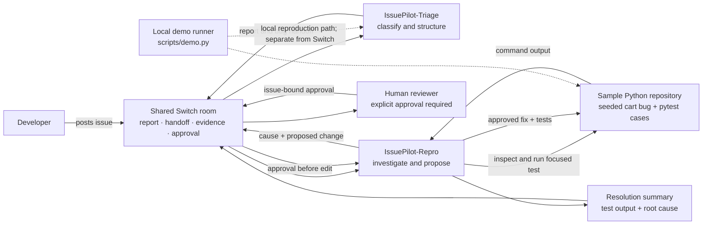

# IssuePilot

> **Turn a bug report into a shared, evidence-backed investigation—with a human in control of every fix.**

IssuePilot is a beginner-friendly prototype for the Flip the Switch Hackathon. It demonstrates how separate triage and reproduction agents can work with a developer in one Switch room, while a small Python project supplies inspectable triage rules, a seeded bug, and a reproducible local workflow.

## Problem

Bug reports often arrive with missing details, bounce between people, and get “fixed” before anyone has confirmed the cause. Teams need a common place to clarify a report, assign investigation, preserve test evidence, and make a deliberate decision before code changes.

## Proposed solution

IssuePilot gives each step a clear owner. **IssuePilot-Triage** classifies the report and structures what is known. **IssuePilot-Repro** investigates the sample repository, records test evidence, and proposes a minimal change. The developer remains in the shared Switch room and must explicitly approve an issue-bound change before any fix is applied.

The repository contains a local demonstration of the deterministic parts. It does not contain a Switch API client or automatic Switch-to-filesystem bridge. To use it with Switch, configure the two agent prompts and shared room in the Switch Console, then use the room as the collaboration and approval trail as described below.

## Architecture

The room is the shared collaboration surface. The local Python runner is a reproducible demo path; it is not a Switch connector.



## How Switch fits

Switch is intended to provide the shared room and agent collaboration context: the developer posts the report, Triage publishes its structured result and mentions Repro, Repro posts investigation evidence and a proposed change, and the human posts an explicit approval or asks for more work. The final evidence goes back into that same room so participants can review one conversation.

**Integration status:** This environment did not provide a Switch connector or authoritative Switch Console documentation. Therefore, this repository only supplies agent prompt files and a precise room workflow. No live Switch room, agent response, automated handoff, or Switch API call has been tested here. Configure agents and rooms only with the capabilities documented in your Switch Console. If agent mentions do not trigger another agent in your setup, use the Console's documented handoff mechanism; do not assume one.

## Agent responsibilities

| Agent | Owns | Must not do |
| --- | --- | --- |
| **IssuePilot-Triage** | Classify as bug, question, or feature request; extract severity, component, reproduction steps, expected and actual behavior; request missing facts; hand off bugs in the room. | Inspect or edit source code; claim a fix or test result. |
| **IssuePilot-Repro** | Reproduce a triaged bug, state exact command/output/exit status, identify root cause, propose a minimal change, and report post-approval test evidence. | Change source before explicit human approval in the same room; claim tests passed unless they actually ran. |
| **Human developer/reviewer** | Clarify reports, review the proposed change, approve or decline, and decide whether evidence is sufficient. | Treat silence or an agent message as approval. |

Full prompts: [`agents/issuepilot-triage.md`](agents/issuepilot-triage.md) and [`agents/issuepilot-repro.md`](agents/issuepilot-repro.md).

## Workflow: report to resolution

1. A developer posts the issue in the shared Switch room.
2. IssuePilot-Triage returns a structured report conforming to [`docs/issue-report.schema.json`](docs/issue-report.schema.json).
3. For bugs, Triage hands the report to IssuePilot-Repro in that room.
4. Repro checks the sample repository, runs the focused test, and posts the exact evidence and suspected root cause.
5. Repro proposes a small change and waits. No approval means no edit.
6. The human reviews and explicitly approves the named issue and change in the room.
7. Only then does Repro apply the change and rerun the relevant tests.
8. Repro posts changed files, exact test output and exit status, root cause, and remaining limitations to the same room.

## Technology stack

- Python 3.10+ for the sample app and workflow.
- pytest for automated regression and triage tests.
- JSON for the sample issue and generated triage/investigation records.
- FastAPI is an optional local demonstration endpoint; it is not required and does not connect to Switch.
- Switch room and agent features are configured separately through the Switch Console; this repository makes no claim that a live configuration has been tested.

## Installation

Use Python 3.10 or newer. From the repository root:

```bash
python --version
python -m venv .venv
source .venv/bin/activate       # Windows PowerShell: .venv\\Scripts\\Activate.ps1
python -m pip install -e '.[test]'
```

The `test` extra installs pytest. If package installation is blocked, use a Python environment where pytest is already available. Do not interpret a missing-pytest error as a test failure or success: the test did not run.

## Configuration

### Local project

No secrets or environment variables are required. The demo reads [`data/sample_issue.json`](data/sample_issue.json), writes `data/triage_result.json` and `data/investigation_result.json`, and runs from the repository root. The triage rules live in `issuepilot/triage.py` and can be inspected directly.

### Switch Console

1. Open the Switch Console and use its documented **Agents** area to create `IssuePilot-Triage`.
2. Paste the contents of [`agents/issuepilot-triage.md`](agents/issuepilot-triage.md) into that agent's instruction field.
3. Create `IssuePilot-Repro` in the same documented Agents area and paste [`agents/issuepilot-repro.md`](agents/issuepilot-repro.md) into its instruction field.
4. Use the Console's documented **Rooms** area to create a shared room and add both agents and the developer.
5. Confirm from the Console's documented behavior how an agent is addressed or handed a task. Use a mention only if supported; otherwise use the documented handoff action. Verify each agent's response appears in the room.

Menu names can differ between Console versions. This guide intentionally does not invent exact buttons, API endpoints, or integrations. If the Console does not support agent-to-agent room handoff, the human can relay the report manually and preserve the same room as the evidence trail.

## Testing instructions

First, run the focused regression on the intentionally buggy starting code:

```bash
python -m pytest -q tests/test_cart.py::test_subtotal_includes_first_item
```

With pytest installed, this assertion is expected to fail because `subtotal([12.50, 3.25])` currently returns `3.25` rather than `15.75`. Then run the complete suite to see all baseline outcomes:

```bash
python -m pytest -q
```

The triage tests should pass; cart tests requiring the first item should fail until an approved fix is applied. The local smoke checks run during preparation confirmed the current function returns `3.25` and the deterministic triage classifications/field extraction behave as expected. **pytest itself was not run successfully in the authoring environment** because pytest was absent and package download was blocked; see the recorded run below.

## Example workflow and actual recorded output

Sample input, abbreviated:

```json
{
  "issue_id": "ISSUE-001",
  "title": "Cart subtotal omits the first item",
  "expected": "15.75",
  "actual": "3.25"
}
```

The actual local demo generated this triage result (selected fields):

```json
{
  "issue_id": "ISSUE-001",
  "kind": "bug",
  "severity": "unknown",
  "component": "cart",
  "reproduction_steps": [
    "Add an item priced at 12.50",
    "Add a second item priced at 3.25",
    "Read the cart subtotal"
  ],
  "expected": "15.75",
  "actual": "3.25",
  "status": "triaged"
}
```

The demo attempted this exact command:

```text
/Applications/Xcode.app/Contents/Developer/usr/bin/python3 -m pytest -q tests/test_cart.py::test_subtotal_includes_first_item
```

Actual captured stderr and exit code:

```text
/Applications/Xcode.app/Contents/Developer/usr/bin/python3: No module named pytest
exit code: 1
```

This means pytest did **not** execute the regression in that environment. The captured record is in [`data/investigation_result.json`](data/investigation_result.json). The demo made no source edit. Run the installation commands above in a Python 3.10+ environment with pytest available to get real test output.

To run the default local demo:

```bash
python scripts/demo.py
```

It writes JSON outputs and prints the room handoff text. It does not contact Switch. After installing pytest, the approved local demonstration can be run with `python scripts/demo.py --approved`; first record the approval in the Switch room using the rule below. That command is a local simulation flag, not a cryptographic or machine-verified Switch approval token.

## Human approval and safety

In the live room, Repro must describe the proposed change and request approval. The human must post a clear issue-bound message, for example:

```text
APPROVE ISSUE-001: include the first cart item
```

Approval for another issue, an agent's statement, or silence does not count. If approval is absent or ambiguous, do not edit. The local demo defaults to `approve=False` and leaves source unchanged. Its `--approved` flag is an explicit local operator choice; it is not connected to, or validated against, Switch. With pytest unavailable, the demo refuses to perform the approved edit because pre-fix evidence could not be collected.

## Limitations and future improvements

Current limitations:

- Classification and severity use simple keyword rules, not an AI model; severity can be `unknown` when the words do not match a rule.
- No Switch API integration or automated handoff is implemented or tested.
- The local `--approved` flag is for demonstration and does not read a Switch room or independently verify a human identity.
- The seeded fix path is narrowly tailored to the known sample line and issue; it is not a general-purpose code patcher.
- No successful pytest run or post-fix resolution is included in the captured environment evidence.

Possible next steps:

- Validate a real Switch room workflow against the current Switch Console documentation and document the exact verified setup.
- Add durable issue IDs, schema validation, and better missing-field questions.
- Add more seeded bugs and component-specific repro instructions.
- Store human approval as a reviewable, issue-linked record and make the runner verify it through a supported, documented mechanism if Switch offers one.
- Add CI on supported Python versions and retain test logs with each investigation.

## Optional FastAPI endpoint

Install the optional dependencies and start the local API:

```bash
python -m pip install -e '.[api]'
uvicorn issuepilot.api:app --reload
```

`POST /triage` accepts `issue_id`, `title`, and `description`. This endpoint only calls local triage logic; it does not send or receive Switch messages.
